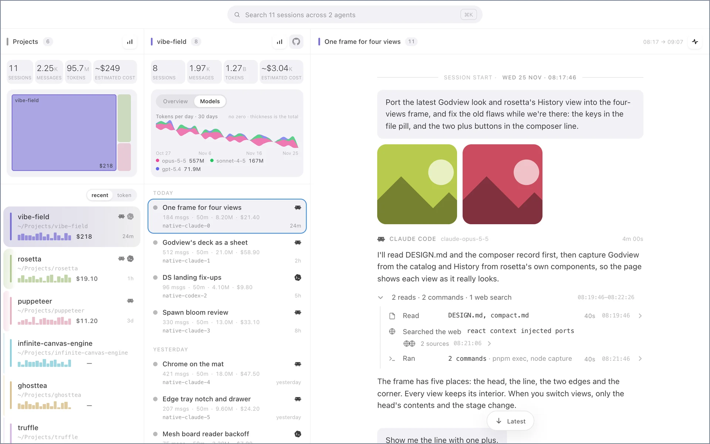
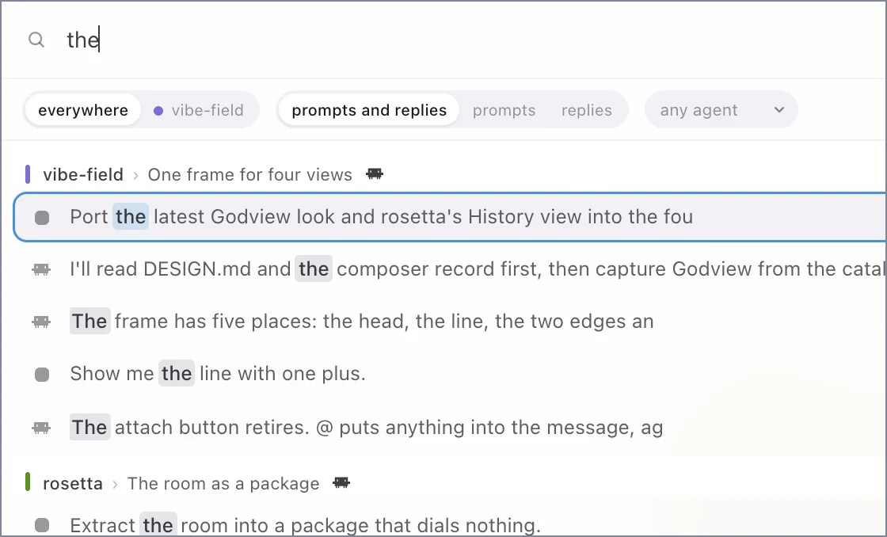
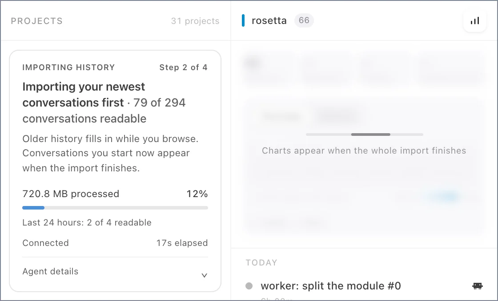
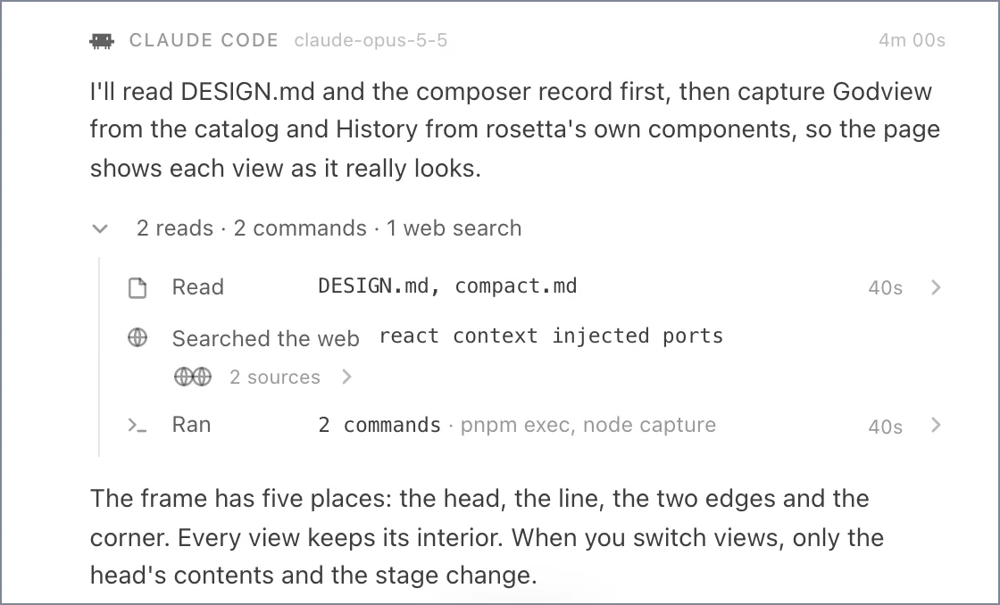
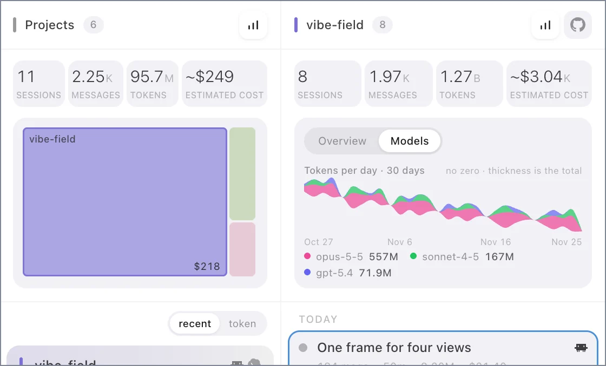

<p align="center">
  <a href="https://github.com/vibefield/rosetta/releases/latest">
    <picture>
      <source media="(prefers-color-scheme: dark)" srcset=".github/readme/hero-dark.svg">
      
    </picture>
  </a>
</p>

<p align="center">
  <b>rosetta is a multi-agent history data ingestion engine.</b><br>
  One local daemon reads the session stores your coding agents already keep on disk, and answers over localhost:<br>
  search across all of them, any conversation as one timeline, and every change as it happens.
</p>

<p align="center">
  <a href="https://github.com/vibefield/rosetta/releases/latest"><b>Download</b></a>&nbsp;&nbsp;·&nbsp;
  <a href="docs/ARCHITECTURE.md">Architecture</a>&nbsp;&nbsp;·&nbsp;
  <a href="docs/site/README.md">API reference</a>&nbsp;&nbsp;·&nbsp;
  <a href="https://www.npmjs.com/package/@vibefield/rosetta-protocol">npm: client</a>&nbsp;&nbsp;·&nbsp;
  <a href="https://www.npmjs.com/package/@vibefield/rosetta-room">npm: room</a>
</p>

<p align="center">
  <a href="https://github.com/vibefield/rosetta/actions/workflows/ci.yml"><picture><source media="(prefers-color-scheme: dark)" srcset="https://img.shields.io/github/actions/workflow/status/vibefield/rosetta/ci.yml?branch=main&label=ci&style=flat-square&labelColor=212437&color=e6eafb"></picture></a>
  <a href="https://github.com/vibefield/rosetta/releases/latest"><picture><source media="(prefers-color-scheme: dark)" srcset="https://img.shields.io/github/v/release/vibefield/rosetta?label=rosettad&style=flat-square&labelColor=212437&color=e6eafb"></picture></a>
  <a href="https://www.npmjs.com/package/@vibefield/rosetta-protocol"><picture><source media="(prefers-color-scheme: dark)" srcset="https://img.shields.io/npm/v/%40vibefield%2Frosetta-protocol?label=npm&style=flat-square&labelColor=212437&color=e6eafb"></picture></a>
  <a href="LICENSE"><picture><source media="(prefers-color-scheme: dark)" srcset="https://img.shields.io/badge/license-MIT-e6eafb?style=flat-square&labelColor=212437"></picture></a>
</p>

<br>

<p align="center">
  <picture>
    <source media="(prefers-color-scheme: dark)" srcset=".github/readme/room-dark.webp">
    
  </picture>
</p>

<p align="center"><sub>The History room, <a href="clients/room"><code>@vibefield/rosetta-room</code></a>, on the demo data the package ships. A screenshot, not a mock.</sub></p>

## Start

Download `rosettad` for your platform from [Releases](https://github.com/vibefield/rosetta/releases/latest) (macOS and Linux, Intel and ARM), unpack it, then:

```sh
./rosettad discover                      # which agents have history on this machine

mkdir -p ~/.local/share/rosetta
./rosettad serve --db ~/.local/share/rosetta/history.sqlite \
  --agent claude-code --agent codex      # or --all-agents
```

It listens on `127.0.0.1:4640` before the import finishes, and keeps watching for changes. From a second terminal:

```sh
curl "http://127.0.0.1:4640/api/status"
curl "http://127.0.0.1:4640/api/sessions?limit=20"
curl "http://127.0.0.1:4640/api/search?q=backoff"
```

Or from TypeScript, with `npm install @vibefield/rosetta-protocol`:

```ts
import { RosettaClient } from "@vibefield/rosetta-protocol";

const client = new RosettaClient(); // http://127.0.0.1:4640

const { sessions } = await client.sessions({ limit: 20 });
const page = await client.timeline(sessions[0].id, { limit: 100 });

// Follow it live: one snapshot, then every change.
const live = client.subscribeSession(sessions[0].id, {
  onChange: (entries) => console.log(entries.length, "entries"),
});
```

## Many agents, one vocabulary

<p align="center">
  <picture>
    <source media="(prefers-color-scheme: dark)" srcset=".github/readme/roster-dark.svg">
    
  </picture>
</p>

Nine agents are read today, and the list is meant to grow. Each agent has one adapter, and everything rosetta knows about that agent's files lives in it and in its evidence under [`groundtruth/`](groundtruth), so adding an agent changes nothing for a client. What comes out is the same for every agent: projects, sessions, and timeline entries of seven kinds. A tool call is read as one of 28 actions (a file read, a shell command, a web search, a delegation), so a client draws "Ran 2 commands" without knowing which agent ran them.

## What you get

<table>
  <tr>
    <td width="50%" valign="top">
      <picture><source media="(prefers-color-scheme: dark)" srcset=".github/readme/tile-search-dark.webp"></picture><br>
      <b>Search across every agent</b><br>
      Full text over prompts and replies, ranked, filtered by project, agent or kind. The index sits beside the projection and is rebuilt on its own.
    </td>
    <td width="50%" valign="top">
      <picture><source media="(prefers-color-scheme: dark)" srcset=".github/readme/tile-import-dark.webp"></picture><br>
      <b>Readable while it imports</b><br>
      The daemon answers before a first import ends. Claude Code and Codex are read newest first, and a conversation opens as soon as it lands. This one is stepped by the room's own simulator; its figures are not measurements.
    </td>
  </tr>
  <tr>
    <td width="50%" valign="top">
      <picture><source media="(prefers-color-scheme: dark)" srcset=".github/readme/tile-tools-dark.webp"></picture><br>
      <b>Tools, read as what they did</b><br>
      Reads, edits, commands, searches, plans and delegated agents, in one vocabulary. Images and videos an agent sent are kept and served.
    </td>
    <td width="50%" valign="top">
      <picture><source media="(prefers-color-scheme: dark)" srcset=".github/readme/tile-usage-dark.webp"></picture><br>
      <b>Tokens and cost, per project</b><br>
      Usage by day and by model, priced at list prices from a catalog kept in the repo. An estimate, and labelled as one.
    </td>
  </tr>
</table>

Also: a Swift client for iOS and macOS, a bearer token and per-session grants for when localhost is not private enough ([`docs/AUTH.md`](docs/AUTH.md)), and linked git worktrees folded into one project.

## How it works

<p align="center">
  <picture>
    <source media="(prefers-color-scheme: dark)" srcset=".github/readme/path-dark.svg">
    
  </picture>
</p>

There are two copies of your history and no third. The **ledger** is append-only and holds every source record as the agent wrote it. The **projection** holds only what a reader needs, and is disposable. It is never migrated: one from an older schema is refused, and `rosettad rebuild` replays a new one from the ledger. Normalizing is a pure function, with no IO, clock or randomness, so a replay gives the same history.

### How an adapter is proven

<p align="center">
  <picture>
    <source media="(prefers-color-scheme: dark)" srcset=".github/readme/proof-dark.svg">
    
  </picture>
</p>

No adapter is written from a guess. Each agent's formats are captured by running the real CLI against a mock model in an isolated runner, and written down in one file per agent. For closed-source agents that is backed by counts of field names and types from real stores, never their content. A field the parser has never seen is kept and reported as drift, never a parse error, so a new release of an agent cannot break reading.

## Put the room in your app

The screenshots above are one React component. It opens no connection of its own: a host hands it ports, and the package's demo ports draw it with no daemon at all.

```tsx
import { HistoryRoom } from "@vibefield/rosetta-room";
import { createDemoPorts } from "@vibefield/rosetta-room/fixtures";
import "@vibefield/rosetta-room/styles/room.css"; // after your --vf-* tokens

<HistoryRoom {...createDemoPorts()} />;
```

The room reads `--vf-*` design tokens that the host defines; rosetta's own set is [`clients/app/renderer/src/styles/tokens.css`](clients/app/renderer/src/styles/tokens.css). The ports, and everything a host may add, are in [`clients/room/README.md`](clients/room/README.md).

## Limits

- **Pre-1.0.** The wire protocol carries its own version, sent on every response, and a mismatch fails with a clear error.
- **Search covers prompts and replies.** Nothing else is indexed yet.
- **Nine agents so far.** Cursor has no adapter yet: its CLI cannot be pointed at a mock model, so its formats have not been captured. A dedicated metrics stream is planned, not built.
- **Plain `serve` trusts the machine.** Any local process can read it unless you start it with `--token-file`.
- **macOS and Linux.** The macOS binaries are unsigned command-line tools, not notarized. There is no Windows build.
- **No published benchmarks yet.** The repo has the harnesses; this page claims no numbers.

## What is in the box

| | What | Get it |
| --- | --- | --- |
| `rosettad` | The daemon: discover, ingest, watch, serve, rebuild, and ledger tools | [Releases](https://github.com/vibefield/rosetta/releases/latest) |
| [`@vibefield/rosetta-protocol`](clients/ts) | TypeScript client and the generated wire types | npm |
| [`@vibefield/rosetta-room`](clients/room) | The History room, as a React 19 component | npm |
| [`RosettaClient`](clients/swift) | Swift client for iOS 18 and macOS 15, no dependencies | SwiftPM, by release tag |
| [`clients/app`](clients/app) | The reference Electron app that hosts the room | from a checkout |

<details>
<summary><b>Development</b></summary>

<br>

Read [docs/ARCHITECTURE.md](docs/ARCHITECTURE.md) before writing code. The 2026-08-28 adapter and client-visibility closure is recorded in [docs/ADAPTER_AUDIT.md](docs/ADAPTER_AUDIT.md).

The [API documentation website](docs/site/README.md) covers onboarding, every HTTP/WebSocket route, the TypeScript client, and generated wire types. Run `npm --prefix docs/site run dev` to open it at `http://127.0.0.1:5190` (Node 22+; no dependency installation required). Build static output with `npm --prefix docs/site run build`.

Proposed lifecycle contracts are documented separately: [daemon ownership and recovery](docs/DAEMON_LIFECYCLE_PROPOSAL.md), [cold/live ingestion controls](docs/INGESTION_API_PROPOSAL.md), and the [desktop/Vibefield integration review](docs/INGESTION_API_REVIEW.md). These additions are not implemented routes.

```sh
# Verify the data/tool boundary and generated artifacts.
python3 -m tools.groundtruth check
python3 -m unittest discover -s tools/groundtruth/tests

# Re-infer schemas from committed fixtures; no package download or agent run.
python3 -m tools.groundtruth farm claude-code --schemas-only
python3 -m tools.groundtruth farm codex --schemas-only

# Verify Rust runtime crates.
cargo test --workspace

# Profile discovery/meta/cold ingest and inspect the final projection.
cd tools/ingest-bench && npm install && npm start
```

`farm` without `--schemas-only` installs and executes downloaded agent CLIs. It fails closed unless run inside a container/VM (prefer a runner image pinned by SHA-256 digest), explicitly attested with `ROSETTA_FARM_ISOLATED=1`, or deliberately overridden with `--allow-host-execution` on a disposable research machine.

The canonical repository is the public [`vibefield/rosetta`](https://github.com/vibefield/rosetta). Use a feature branch and pull request, then squash merge after **CI passed** succeeds. CI runs on pull requests and `main`, and can be started manually. It checks workflow syntax, the committed ground-truth artifacts, Python tests, Rust formatting, Clippy with warnings denied, and workspace tests on Linux and Apple Silicon macOS. The npm job builds both libraries and the app, runs the SDK and complete app unit suites, checks documentation, tests the packed libraries in a clean consumer, exercises the room host in Electron, and characterizes a cold import (scale 0.25) in Electron. Rust comes from `rust-toolchain.toml`; builds use the committed `Cargo.lock` with `--locked`. The evidence tools require Python 3.12 or newer; CI uses Python 3.13. External actions are pinned to commit SHAs. Workflow tokens default to read-only; only the draft-release job receives contents-write permission, and only the npm publish job receives an OIDC identity. Dependabot proposes weekly grouped Rust, npm, and GitHub Actions updates. Review and merge those through CI.

</details>

<details>
<summary><b>Releasing: npm packages</b></summary>

<br>

The public packages are `@vibefield/rosetta-protocol` (SDK and wire types) and `@vibefield/rosetta-room` (React room, fixtures, and styles). Both ship compiled ESM and declarations. React 19 is supplied by the room's host. Package versions move together; the wire protocol version remains independent. Both are MIT licensed and ship the `LICENSE` file.

Use Node 24 and npm 12.0.1 for development and releases:

```sh
npm ci
npm run build
npm test
npm run check:packages
```

One root lockfile covers the protocol, room, and private app. Mille dependencies come from npm; no sibling checkout is required. `check:packages` builds tarballs in `dist/npm`, installs them in a temporary consumer, tests ESM and shared grant vectors, checks NodeNext declarations and the DOM-free version export, then bundles the room and its CSS. The tarballs include only `dist`, package metadata, and the README.

The first publish uses an authenticated maintainer, after the checks above:

```sh
node tools/npm/publish.mjs
npm trust github @vibefield/rosetta-protocol --repo vibefield/rosetta --file npm-release.yml --allow-publish --yes
npm trust github @vibefield/rosetta-room --repo vibefield/rosetta --file npm-release.yml --allow-publish --yes
```

Trust setup may require account 2FA. A new trusted publisher must complete its first successful publish within two days or it expires; a manual dry run does not activate it. See [npm's trusted-publisher requirements](https://docs.npmjs.com/trusted-publishers/#trusted-publisher-configuration-expiry). Future releases use GitHub-hosted OIDC without an npm token secret. The public source repository supports npm provenance, which the publish job explicitly enables. The **npm release** workflow publishes only on `npm-v*` tag pushes; a manual run is a complete dry run. It checks main ancestry, stable tag/version agreement, all CI, and the exact tarballs before publishing protocol first and room second. Reruns skip only versions whose registry integrity exactly matches the verified artifact.

For the next version, update both library manifests, the protocol dependency in the room, and both Rosetta dependencies in the app. Refresh the root lockfile and merge through **CI passed**. Tag that main commit, using its version (for example):

```sh
git tag -a npm-v0.1.2 -m 'Rosetta npm 0.1.2'
git push origin npm-v0.1.2
```

Use `gh workflow run npm-release.yml --ref main` to verify a release without publishing.

</details>

<details>
<summary><b>Releasing: daemon archives</b></summary>

<br>

The **Release** workflow builds native `rosettad` archives for Linux x64/ARM64 and macOS Intel/Apple Silicon. Linux archives target Ubuntu 24.04's glibc environment; macOS archives are unsigned command-line binaries, not notarized desktop installers. Each archive contains the binary, README, `LICENSE`, and `BUILD.json` with version, target, source commit, and compiler. Builds run a discovery smoke test against an empty home directory. `SHA256SUMS` verifies the four archives.

To exercise delivery without publishing a version:

```sh
gh workflow run release.yml --repo vibefield/rosetta --ref main
```

Download the `release-bundle` artifact from that run within seven days. For a release, merge the version update in `[workspace.package]` in `Cargo.toml` and the resulting `Cargo.lock` changes, then tag that exact commit on `main`:

```sh
git switch main
git pull --ff-only
# Replace 0.1.0 below with the version committed in Cargo.toml.
git tag -a v0.1.0 -m 'Release v0.1.0'
git push origin v0.1.0
```

The workflow rejects mismatched versions and commits outside `main`, reruns CI, builds all four archives, verifies their checksums, then creates a **draft** GitHub Release with generated notes. Review its assets and publish the draft in GitHub. Rerunning publication for an existing release fails rather than replacing assets; if a draft needs correction, delete only that unpublished draft before rerunning. Manual workflow runs never publish, even when dispatched against a tag. No cloud account, deployment secrets, or automatic desktop updater is configured here.

The public repository enforces **CI passed** and pull requests on `main`, including for administrators. The policy is recorded in `.github/main-protection.json`; to reapply it:

```sh
gh api --method PUT repos/vibefield/rosetta/branches/main/protection \
  --input .github/main-protection.json
```

That policy requires an up-to-date passing CI run and a pull request, blocks force pushes/deletion, requires resolved conversations, and applies to administrators. It allows zero approving reviews so a sole maintainer can merge their own PRs.

</details>

## License

Rosetta's own code is released under the [MIT License](LICENSE). That grant does not extend to material kept here that belongs to others: the agent fixtures, schemas, and censuses under `groundtruth/` remain their respective owners', and the vendored price data in `crates/pricing/catalog/genai-prices/` carries its own license file.

<br>

<p align="center">
  <a href="https://github.com/vibefield">
    <picture>
      <source media="(prefers-color-scheme: dark)" srcset=".github/readme/vibefield-dark.svg">
      
    </picture>
  </a>
</p>

<p align="center">
  <sub><a href="LICENSE">MIT</a> © 2026 James Yong. rosetta is the history engine of <a href="https://github.com/vibefield/vibefield">VibeField</a>.</sub>
</p>
