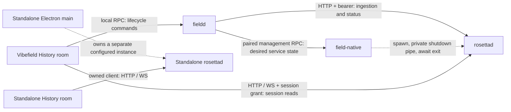

# Daemon ownership, control, and recovery

**Status: proposed implementation design, revised 2026-10-06. Not implemented.**
Protocol 26 remains the current API. Flags, lifecycle frames, health fields, and
SDK additions on this page are proposed. Assign the release's actual wire version
when implementation lands; this document does not reserve a version number.

**Ownership correction, 2026-10-06:** the initial proposal carried forward
VibeField's current fieldd supervisor as a constraint. The platform review reopens
that choice: the recommended target is field-native supervising separate Rosetta
and Files processes, with fieldd retaining product policy. The existing agent
design already names native supervision as Rosetta's upgrade path. This revision
states that direction; native process management, Files control transport,
credential recovery, and upgrade ordering still need a platform-wide contract.

This is the process-management companion to the
[ingestion API](INGESTION_API_PROPOSAL.md). That document owns cold/live job
semantics; this one owns process lifetime, host supervision, and connection
identity. The [integration review](INGESTION_API_REVIEW.md) records the current
consumer evidence. Neither document changes the storage laws in
[ARCHITECTURE.md](ARCHITECTURE.md) or the existing [access rules](AUTH.md).

## 1. Decisions

1. **One supervisor owns one foreground child per configured index.** The proposed
   VibeField owner is field-native; current code still uses fieldd. In standalone
   Rosetta, Electron main remains the owner.
   Rosettad never forks into the background or supervises itself.
2. **Ingestion commands use the existing HTTP/JSON service.** Keep Rust-owned
   generated types, loopback TCP, and the existing WebSocket data streams. A gRPC
   migration, a second job protocol, and an embedded Rust addon are not required.
3. **Process shutdown uses a private inherited pipe.** An opt-in supervised mode
   reserves stdin for a single shutdown command and owner-loss detection. It is
   not a second ingestion API. The pipe's write handle belongs only to the owner;
   renderer credentials and session grants cannot shut down the process.
4. **Every launch has a distinct identity.** Process instance, logical index,
   published projection, and ingestion run have separate identities and lifetimes.
5. **A timeout is not proof of exit.** An unconfirmed child remains owned. No
   replacement is spawned until an OS exit notification or equivalent process
   handle proves it is gone. The exclusive projection lock remains a second guard.
6. **Shutdown preserves ingestion intent.** Closing an app, changing enrollment,
   restarting a process, and losing a parent never mean discard, redo, or user pause.
7. **Choose lifetime independently of the product connection.** In the proposed
   VibeField topology, a fieldd restart leaves the native-owned Rosetta process
   running; fieldd reconnects and reconciles product authority. Loss of the native
   supervisor closes the child's owner pipe. Standalone Rosetta remains bound to
   its Electron host. No process has two competing supervisors.

These choices extend the existing localhost HTTP/WS decision in Architecture §5.1.
HTTP is an established daemon interface; for example, the
[Docker Engine API](https://docs.docker.com/reference/api/engine/) uses HTTP.
Unix sockets or named pipes remain possible native transports if there is a
concrete requirement; browser-facing readers would still need an HTTP or host path.



The two hosts use separate configured projections. If configured to use the same
projection, the second owner receives `index_in_use`; it never takes ownership by
killing the first. Data readers may share a daemon without becoming its owners.

## 2. Ownership and identity

| Identity | Lifetime | Purpose |
|---|---|---|
| `instance_id` | One spawn attempt; fresh UUID generated by its supervisor | Reject stale readiness, connections, callbacks, and process controls. An unmanaged CLI launch generates its own. |
| `index_id` | Durable lifecycle control store; survives process restart and archive redo | Bind a user's ingestion command to one logical index. It is not a pathname or PID. |
| `projection_generation` | One published canonical generation | Bind readers, search, and cache invalidation to the serving archive. |
| `ingestion_id` | One cold run, including recovery and pause/resume | Reconcile durable commands and progress. |
| `progress.epoch` | One comparable set of RAM observations | Reset rates after recovery or enrollment changes. |

The host holds one immutable connection snapshot internally:

```typescript
type DaemonConnection = {
  instanceId: string;
  origin: string;
  protocolVersion: number;
  credential: RosettaCredential | null;
};
```

The credential type is the existing SDK type. Origin, instance, and credential
change together. This object is never a public health object. Fieldd does not
forward its bearer to the renderer. Its direct session tickets retain their
existing restricted grants and add the serving instance identity when supported.

The standalone host retains its documented open-local compatibility profile;
fieldd continues requiring bearer and grant support. HTTP routes enforce the
configured access mode. The private process pipe works in either mode and adds
no unauthenticated administration endpoint. A separate change to standalone's
credential/discovery policy must account for its sibling readers before changing
that default. Open-local mode is not isolation from other local processes.

## 3. Managed launch and bootstrap

### 3.1 Proposed launch contract

The owner adds these proposed flags to its existing `serve` command:

```text
--supervised-stdio --instance-id <fresh UUID> --json
```

It spawns the executable directly with `stdio: ["pipe", "pipe", "pipe"]`, an
explicit argument array, and no shell. Existing `--db`, `--enroll`, ephemeral
loopback binding, Origin configuration, and credential files keep their roles.
The instance id is not a credential. Secrets stay out of argv, ready frames,
announcement files, logs, and public health.

`--supervised-stdio` requires `--instance-id`, `--json`, and a piped stdin; an
interactive terminal is invalid. Ordinary CLI `serve` does not monitor stdin:
redirecting stdin to `/dev/null` must not stop an unmanaged daemon. Closing stdin
in supervised mode always means ownership has ended, including before ready.
No child or unrelated worker may inherit a duplicate of the owner's write handle.

Install the owner-pipe reader, Unix signal handlers, and shutdown latch before
any potentially expensive recovery or ingestion. Acquire the index lock without
waiting indefinitely. Initialize the control/status service before starting
discovery, replay, or capture. Publication reconciliation may keep job mutations
unavailable, but must remain observable through status once control is ready.
If shutdown wins during initialization, do not emit ready or auto-start ingestion;
finish the bounded drain and exit.

### 3.2 Readiness

Keep the existing JSON `ready` event and its `origin`, `protocol_version`,
`announce`, and `auth` fields. Add:

| Field | Contract |
|---|---|
| `supervisor_protocol` | Integer `1` for this private process protocol. Independent of the public API version. |
| `instance_id` | Exactly the UUID supplied for this spawn. |
| `capabilities` | Includes `owner-control-stdio-v1` and `health-v1` when implemented. |

Ready means the instance owns the index lock, has installed its lifecycle
coordinator, and can answer health/status. It does not mean cold ingestion,
publication reconciliation, or search has completed. Paused and failed ingestion
are compatible with a ready process.

Before publishing a usable connection, the host validates the instance id,
supervisor version, exact public protocol version, loopback origin, and required
authentication modes. It then confirms the same instance through authenticated
`GET /api/health`. All steps share the startup deadline. A late event from a
previous child cannot change the new child's state.

In supervised mode stdout is bounded lifecycle NDJSON; diagnostics use stderr.
Recognized events are `ready`, `shutdown_started`, and `fatal`. Unknown event
names/extra fields are ignored within bounds for additive compatibility;
malformed recognized events and unsupported supervisor versions fail startup.
No host scrapes progress or enrollment errors from human prose in this mode.
Structured fatal details may contain runtime ids, not raw source data or secrets.
Legacy CLI output remains a separate compatibility mode.

A fatal event uses the existing error shape with a typed startup/service code:

```json
{
  "event": "fatal",
  "supervisor_protocol": 1,
  "instance_id": "c6fb255a-c847-4c6d-94b5-29cb3cfc9cd2",
  "error": {
    "code": "index_in_use",
    "message": "Another process owns this index.",
    "details": null
  }
}
```

Supervised mode also has stable exit classes, so a lost final frame does not
turn a known terminal failure into a retry loop:

| Exit | Meaning | Owner response |
|---|---|---|
| `0` | Completed graceful termination. | Stop if requested; otherwise treat the unexpected exit as a bounded recovery event. |
| `1` | Unexpected/internal failure or forced self-termination. | Bounded retry when desired state is running. |
| `2` | Invalid configuration, access setup, or owner-control protocol. | Manual recovery; no automatic retry. |
| `3` | Index lock held elsewhere. | One bounded handoff retry (§8), then explicit refusal. |
| `4` | Evidence/schema recovery requires an explicit operator action. | Manual recovery; never erase or rebuild implicitly. |

An OS signal/forced kill remains an abnormal exit. The supervisor's already-known
reason (intentional stop, incompatible ready, startup timeout) takes precedence
over an exit code when deciding whether to restart. Worker failures that the
service can expose as a failed ingestion stay in the resource contract, not this
fatal channel. CLI exit behavior outside supervised mode is not changed here.

## 4. The private shutdown protocol

### 4.1 Owner command

One UTF-8 JSON object per newline, at most 4 KiB including the newline:

```json
{
  "supervisor_protocol": 1,
  "command": "shutdown",
  "instance_id": "c6fb255a-c847-4c6d-94b5-29cb3cfc9cd2",
  "request_id": "7ffea3f0-c24c-47e8-8da9-b7ed272aeb53",
  "reason": "enrollment_changed",
  "grace_ms": 10000
}
```

`reason` is `host_shutdown`, `process_restart`, `enrollment_changed`, or
`startup_failed`. It is diagnostic only: none changes durable ingestion intent.
`grace_ms` is an integer from 1,000 to 30,000; hosts default to 10,000. The daemon
starts a monotonic deadline at admission; the parent starts its own deadline
before writing, so a blocked pipe cannot extend the stop budget.

The first valid command closes mutation admission and latches shutdown. A repeat
of the same request returns the same acknowledgement. Subsequent shutdown requests
may shorten the deadline but never extend it. The first reason/request remains
the initiating cause. A wrong instance, invalid version, oversized line, or invalid
command records `invalid_owner_control` and starts orderly termination; it never
executes another command. Pipe EOF or read failure independently initiates
`owner_lost` with the default budget. Bytes after a valid shutdown cannot cancel it.

The only acknowledgement is an observation of draining, not proof of termination:

```json
{
  "event": "shutdown_started",
  "supervisor_protocol": 1,
  "instance_id": "c6fb255a-c847-4c6d-94b5-29cb3cfc9cd2",
  "request_id": "7ffea3f0-c24c-47e8-8da9-b7ed272aeb53",
  "reason": "enrollment_changed"
}
```

For EOF/signals, `request_id` is null and the reason is `owner_lost`, `sigterm`, or
`sigint`. Frames are best effort: draining must proceed even if stdout is broken
or its reader stopped. There is no persistent shutdown receipt or process command
queue; this instance can be shut down only once. The parent's OS child-exit event
is the completion signal.

### 4.2 Shutdown sequence

1. Atomically latch process state `draining` and close admission for new writes.
   Resolve an already accepted ingestion idempotency key before rejecting new
   commands with `503 shutting_down`. Status and safe reads remain available.
2. Stop new capture admissions and watcher scheduling. Finish or abandon current
   work only at existing recoverable raw-frame/cursor/transaction boundaries.
   Persist accepted user pause/discard intent before reporting it accepted.
3. Keep publication's existing fence. If commit already crossed it, finish the
   coherent commit or leave its durable recovery intent; never report an
   uncommitted generation as succeeded. A shutdown deadline can force crash
   recovery but cannot weaken that publication rule.
4. Drain and sync required evidence/control records, then stop writer, capture,
   search, and maintenance workers. Search remains disposable; no need to finish
   a full search build merely to exit.
5. Close WebSockets with a going-away signal, drain bounded HTTP requests, release
   readers/store handles, remove this instance's announcement, and release the
   projection lock last. Exit normally only after required work has joined.

The shutdown latch interrupts execution without writing `desired_state: paused`.
An accepted cold/live user pause survives; previously running intent recovers on
the next normal launch. Discard intent continues cleanup. Client disconnects do
not become shutdown or cancellation. See the ingestion proposal for these states.

### 4.3 Platform behavior and deadlines

Both desktop hosts first use the pipe on every platform. This also works before
HTTP is ready and avoids introducing an HTTP shutdown route. After the grace
deadline, the owner forcefully terminates its owned child and waits up to another
2 seconds for confirmed exit. A write error merely advances the stop path; it
does not prove that the child exited. Repeated stop calls share the same operation.

On Unix, both SIGTERM and SIGINT enter the same graceful path. A second explicit
termination signal may force exit. Ordinary CLI Ctrl-C continues to work.
On Windows, a console control event may enter that path, but Node's
`child.kill("SIGINT")` must not be used as the graceful mechanism: Node documents
that it terminates abruptly on Windows. [Node child-process behavior](https://nodejs.org/api/child_process.html#subprocesskillsignal).

The daemon has an independent bounded drain watchdog, also activated on owner
loss. If the grace budget expires, it terminates abnormally without claiming a
clean checkpoint. That emergency exit may skip destructors, so crash recovery is
mandatory. Windows Job Objects with kill-on-close can add containment in a native
host adapter; such a kill is also a crash, not a graceful drain. They do not
replace the pipe or the non-overlap rule.
[Windows Job Objects](https://learn.microsoft.com/en-us/windows/win32/procthread/job-objects).

If no OS exit evidence arrives, return `exit_unconfirmed`, retain the child handle
and instance identity, publish a non-retryable ownership failure, and refuse new
launches. Keep listening for the real exit. A timer must never call the same
cleanup path as an actual child exit. An app may finish closing, but it must not
claim the daemon stopped or delete a live lock. The next host also honors that lock.

## 5. Host supervisor state machine

Use one serialized owner loop; asynchronous callbacks submit events tagged with
their instance id. Coalesce concurrent ensure/stop/restart requests. Once stop
wins admission, it cancels queued retries and restarts; late ready/probe results
cannot reopen a connection. Never start a replacement while an old spawn or exit
is unresolved. Explicit process restart is stop-confirmed-then-start, never redo.

| State | Meaning | Next actions |
|---|---|---|
| `stopped` | No owned live process, desired state stopped. | ensure-running |
| `starting` | Spawn/handshake in progress. | join existing ensure, stop |
| `ready` | Validated process connection. | observe, stop, restart |
| `stopping` | Shutdown requested; exit not yet confirmed. | join stop |
| `backoff` | Prior exit confirmed; bounded retry scheduled. | wait, stop |
| `failed` | Automatic recovery stopped. | explicit retry only when ownership permits |

`failed` carries a typed code, `retryable`, and `exit_confirmed`. Keep a nullable
`instance_id`/PID if an owned process still exists. `exit_unconfirmed` remains
failed even if the UI's stop request has returned. A later verified exit clears
ownership but does not silently override the user's stopped/failed intent.

Starting policy and limits are shared constants, with test overrides:

| Budget | Proposed default |
|---|---|
| One spawn through ready + health confirmation | 8 seconds, matching current per-attempt budget |
| Initial lock handoff | One wait of up to 12 seconds, then one fresh attempt; 30 seconds total startup budget |
| Graceful drain | 10 seconds |
| Post-force exit confirmation | 2 seconds |
| Unexpected-exit backoff | Equal jitter: half to all of `min(10s, 500ms × 2^attempt)` |
| Automatic recovery intensity | At most 5 retries in a rolling 60 seconds |
| Stable ready period | 30 seconds before resetting the backoff exponent |
| Lifecycle output | At most 8 KiB per line; bounded parsing and drain queues |
| Retained diagnostic tail | At most 64 KiB per instance, redacted before public projection |

Use monotonic elapsed time. Healthy time resets the exponent, not recent failure
history. Explicit restart is not a crash; configuration, permission, incompatible
protocol, and invalid control channel failures do not auto-loop. `index_in_use`
has only the single bounded handoff retry described in §8.
Preserve a terminal startup error even if its stderr/fatal frame races the exit
event. Spawn failure with no process is distinct from a failed signal to a live one.

No process monitor uses ingestion progress as a heartbeat. A quiet archive,
paused work, failed ingestion, absent enrollment, or building search cannot by
itself trigger process recovery.

## 6. HTTP health, connection fencing, and control

### 6.1 Proposed health endpoint

`GET /api/health` is a small daemon-level read under the existing auth rules.
Session grants cannot use it. It has no SQLite work, filesystem scan, transcript
payload, or blocking wait for the writer/coordinator. It returns HTTP 200 with
`Cache-Control: no-store`, the normal protocol header, and this shape:

```json
{
  "instance_id": "c6fb255a-c847-4c6d-94b5-29cb3cfc9cd2",
  "state": "ready",
  "accepting_mutations": true
}
```

`state` is `ready` or `draining`; the latter has `accepting_mutations: false`.
During publication reconciliation, a ready instance may also report false.
This field describes global admission, not permission or eligibility for a
particular action. `/api/status` and each resource's `allowed_actions` explain
those details. Process liveness does not certify writer progress or data readiness.

Add `daemon.lifecycle` to status with the same process identity/state/admission
projection. Add `x-rosetta-instance-id` to routed responses and `instance_id` to
WebSocket hello. Expose the response header to allowed browser origins. Fieldd's
health projection may include the opaque instance id, never the bearer or paths.

One host monitor polls health every 5 seconds with a 2-second timeout and no
overlapping probes. Three consecutive transport failures for the same ready
instance may trigger a bounded supervised restart. Success clears the count;
credential/protocol/identity mismatches are explicit terminal faults. Do not
accumulate missed polls across suspension; clear strikes on resume and allow
10 seconds before automated recovery. These are initial budgets to validate on
loaded machines, not claims of measured latency.

### 6.2 Preventing a command from reaching the wrong index

All **new ingestion lifecycle mutations** require `X-Rosetta-Index-Id`, taken
from `status.ingestion.index_id`. The coordinator checks it after authentication
and before consulting idempotency receipts. A mismatch returns
`409 index_changed` and performs no work. This is a logical target precondition,
not authentication, an ETag, or a process-generation condition.

Keep `Idempotency-Key`, expected control revision, and replacement generation
unchanged across an uncertain retry to a new process serving that same index.
Do not require the old process instance on such a replay. A deliberate account,
device, or index switch cancels pending UI intent; it never retargets that command.
The SDK sets the new header from a pinned index context and CORS allows it.

Add an atomic SDK connection update, conceptually
`setConnection({ baseUrl, credential, instanceId })`. It invalidates old reads,
repoints subscriptions, and verifies response/hello instance identities. Keep
the existing setters for legacy clients. New managed adapters use the atomic
operation and reject results from old instances even if a port is reused.
This supplements the projection-generation cache boundary; the two identities
must not be substituted for each other.

### 6.3 The application's command path

The [ingestion contract](INGESTION_API_PROPOSAL.md) remains authoritative:
six cold routes, three live routes, optional `RoomPorts.ingestion`, and one status
overview. Fieldd supplies audited local `index.ingestion.*` / `index.live.*`
methods. Lifecycle reads use `index.read`; mutations use `index.manage`. The
standalone adapter uses its owned SDK client. Grant reach stays unchanged.

`system.index.restart` remains the existing local `native.admin` process action.
It is not retried automatically after a lost RPC reply: its current method
contract is non-idempotent. Reconcile process health first. Inside a host,
concurrent restart requests targeting the same observed instance coalesce; a
request queued for an old instance must not bounce an already-ready successor.
No History button translates a pause or archive rebuild into this method.

## 7. Rust implementation boundaries

The following are proposed modules/seams, not new implemented APIs:

| Location | Responsibility |
|---|---|
| `crates/protocol` | Health/lifecycle types, supervisor frames, typed errors; generated TS and golden vectors. |
| `crates/rosettad/src/lifecycle.rs` | Process shutdown latch, pipe/signals, deadlines, instance identity, worker joining. |
| `crates/rosettad/src/ingestion.rs` | Cold/live coordinator, durable intent, command serialization, writer ownership. |
| `crates/rosettad/src/serve.rs` | Compose services and workers; preserve automatic startup and recovery. |
| `crates/server` | Validate requests and submit commands through an injected interface; fast health reads. |
| `clients/ts` | Generated contracts, atomic connection updates, typed lifecycle requests/errors. |
| Both host supervisors | Spawn, validate, monitor, stop, wait, and apply bounded retry policy. |

Dependencies continue pointing upward: `server` does not import `rosettad`.
Define the injected command/status interface at the service boundary and
implement it in the executable. No protocol type imports native parsers or paths.

Use a bounded control channel and nonblocking admission. Reserve capacity for
pause/discard/stop, and reject excess admissions with typed busy/capacity errors.
The shutdown latch remains out of band so a full job queue cannot prevent exit.
Do not hold a coordinator lock while parsing, syncing, waiting for workers, or
serving an HTTP response. One serialized commit boundary owns state transitions.

Process lifetime cancellation and ingestion pause are separate signals. Workers
observe cancellation cooperatively at recoverable boundaries; tracking/joining
covers Tokio tasks and dedicated threads. `CancellationToken` and `TaskTracker`
are suitable primitives, but dropping a task handle is not a worker drain.
Tokio describes notification and task joining as separate shutdown steps.
[Tokio shutdown guidance](https://tokio.rs/tokio/topics/shutdown).

Read the supervised stdin pipe on a dedicated bounded native I/O thread, and
hand commands to the lifecycle latch. Do not introduce an uncancellable
`tokio::io::stdin()` read into a runtime that must finish shutdown: Tokio
documents that it can keep runtime shutdown waiting for input. A dedicated
reader is not joined indefinitely; pipe closure normally completes it, while the
overall deadline still bounds process termination.
[Tokio stdin behavior](https://docs.rs/tokio/latest/tokio/io/fn.stdin.html).

Keep CPU-heavy parsing and blocking storage work off the control reactor, bound
in-flight work, and check stop requests between existing durable batches. Signal
handlers never write SQLite or delete files. Minimal control identities/receipts
stay outside canonical user data; there is no second progress or normalized-op log.

## 8. Enrollment, orphan recovery, and upgrades

Enrollment remains a host-owned file in Vibefield. Publish it atomically, request
a supervised process restart, wait for verified exit, then spawn against the
latest complete revision. Changes received during one restart coalesce; if a
newer revision arrives after spawn, serialize a subsequent restart. Report the
revision actually loaded rather than claiming a later write was applied.
Cold/live recovery follows current enrollment and preserves accepted pause intent.
Hot reload is a separate later feature, not a second authority in this release.

With the proposed native owner, fieldd owns enrollment policy and requests that
restart through the paired native management channel. field-native owns the
child handle, stop/reap sequence and loaded configuration revision. A product
connection loss alone is not an enrollment change or a restart request.

Owner EOF normally drains a managed orphan without waiting for a later host.
Announcement files remain discovery hints, not permission to terminate a PID.
A responding endpoint and a matching protocol header alone do not prove that
an announced PID still identifies that process. Never unlink a held lock or
signal an unverified PID merely to make startup succeed.

After a host crash, the old child may still be inside its 10-second owner-loss
drain when the new host first launches. An `index_in_use` startup refusal gets
one handoff wait of up to 12 seconds and one retry, after the refusing child has
actually exited. The overall initial budget is 30 seconds, including the two
8-second attempts. Expose the waiting state promptly; outer app/fieldd readiness
must not depend on the index becoming ready. Stop cancels this wait. A second
lock refusal becomes terminal `index_in_use`; it never enters a crash loop or
authorizes a signal to the other owner. This also handles a concurrently running
legitimate owner safely, at the cost of a bounded wait.

For an unexpected legacy orphan that keeps the lock, leave that explicit recovery
state unless ownership can be verified using a live OS process handle and identity.
Normal upgrades shut down the old child through its existing verified owner
before switching binaries. Managed mode is enabled only with a matching binary;
an unknown flag/capability fails clearly instead of falling back silently.

Vibefield consumes `rosetta-pin`, not the working checkout. Upgrade its binary,
protocol/room packages, independent fieldd schemas, tickets, adapters, contracts,
and fixtures together. Publish new origin/credential/instance snapshots atomically.
Preserve public API version checks independently of the private supervisor version.

An always-on deployment still needs an explicit outer service-host decision for
the daemon pair, such as a per-user LaunchAgent, a systemd user service, or an
appropriate Windows service host. Account/session lifetime and upgrade ordering
need their own contract; they do not follow merely from closing a window.
The same foreground rosettad child contract works underneath. Apple's guidance
supports per-user agents and prohibits self-daemonizing under launchd; systemd
also provides explicit readiness and bounded restart policies.
[launchd](https://developer.apple.com/library/archive/documentation/MacOSX/Conceptual/BPSystemStartup/Chapters/CreatingLaunchdJobs.html),
[systemd](https://github.com/systemd/systemd/blob/main/man/systemd.service.xml).

## 9. Delivery and acceptance

| Stage | Deliverable | Release gate |
|---|---|---|
| A — Process foundation | Rust managed pipe/signals, health/instance identity, bounded stop; both host state machines | Real subprocess tests on macOS, Linux, and Windows; no new ingestion buttons yet. |
| B — Application control | Coordinator, index precondition, generated SDK, host RPC/room adapters, status overview | Existing auto-start works; durable cold/live pause, resume, and unfinished cleanup pass recovery tests. |
| C — Archive replacement | Retention, coherent publication, generation events and cache reset | Retired/deleted-source history survives; both read paths remain coherent across replacement. |
| D — Optional service packaging | Explicit background lifetime and native containment | Installation, logout/reboot, upgrade, and ownership tests for each supported platform. |

Stage A must fix the existing SIGINT-only Rust shutdown path, Windows's abrupt
Node signal behavior, the standalone supervisor's unbounded retry intensity,
and fieldd's post-kill timeout path that currently calls `generation.exitedBy`
without an observed exit. These are implementation targets, not claims of fixes
in this documentation change.

Use a deterministic clock/fake child for state-machine races and a real fixture
daemon plus real Rust subprocesses for platform behavior. Each scenario must
assert the process count, final ownership state, and recoverable artifacts:

| Scenario | Required outcome |
|---|---|
| Fragmented ready, stale ready, wrong version/auth/instance | Only the matching authenticated generation becomes usable. |
| Stop before ready; simultaneous ensure/restart/stop | At most one child; a winning stop prevents late startup/retry. |
| Repeated shutdown, broken stdin, duplicate command, stdout backpressure | Bounded drain; no extended deadline or acknowledgement mistaken for exit. |
| Kill timeout; failed signal; delayed real exit | `exit_unconfirmed` retains ownership; no successor until confirmed. |
| Parent exits/crashes before or after ready | Owner EOF drains or forces bounded abnormal exit; one bounded handoff retry handles the old lock. |
| Unix SIGTERM/SIGINT; Windows pipe shutdown | Correct graceful path on every platform, verified against real processes. |
| Crash loop, missing binary, malformed enrollment, lock held | Bounded retries or terminal error, with actionable typed detail. |
| Heavy capture and suspend/resume | Health remains responsive; missed sleep intervals do not create restart storms. |
| Pause/commit/discard races with shutdown or publication | Accepted intent survives; raw evidence and serving generation remain recoverable. |
| Lost mutation reply during origin/token rotation | Same index/key reconciles one operation; different index is refused. |
| Legacy CLI with closed stdin and second desktop owner | CLI stays up; second owner receives a lock refusal without killing the first. |
| Same project/session ids after archive publication | Generation invalidates both hosts' caches and old in-flight answers. |

Record structured spawn/ready/drain/forced-exit/retry/ownership-failure events with
instance id and elapsed time. Record ingestion operation ids separately. Exclude
bearers, grant keys, transcript contents, and native root paths from public health.
Measure startup/drain distributions and forced-exit frequency before tuning the
initial budgets. A health timeout is an observation, not a data-loss diagnosis.

## Source anchors

- `crates/rosettad/src/serve.rs`: early HTTP service, current Ctrl-C handling, raw recovery, worker lifetime.
- `crates/rosettad/src/main.rs`: exclusive projection lock and CLI ownership.
- `clients/app/electron/daemon-service.mjs`: standalone spawn, ready parser, retry, and signal ladder.
- `clients/app/electron/main.mjs`: host state bridge and app shutdown.
- Vibefield `packages/fieldd/src/rosettad-supervisor.ts`: per-user owner, credentials, retry limits, kill timeout, orphan handling.
- Vibefield `packages/fieldd/src/agent-index.ts`: HTTP translation and enrollment restart.
- Vibefield `packages/fieldd-supervisor/src/supervisor.ts`: outer fieldd ownership; adopted instances are not owned children.
- Vibefield `docs/AGENT_PLANE.md`: fieldd-lifetime rosettad and cross-repository boundaries. Update its seam links and umbrella when the implementation lands.
